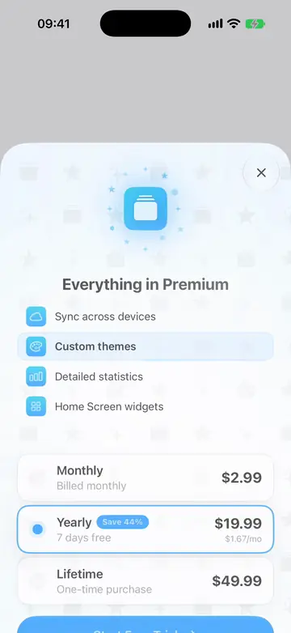
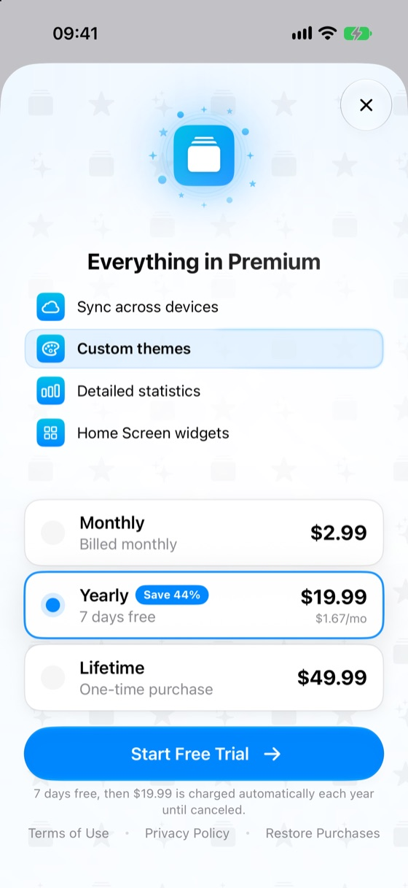
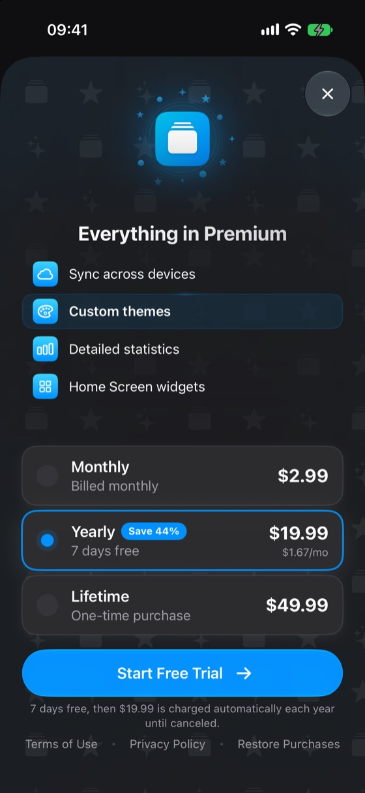
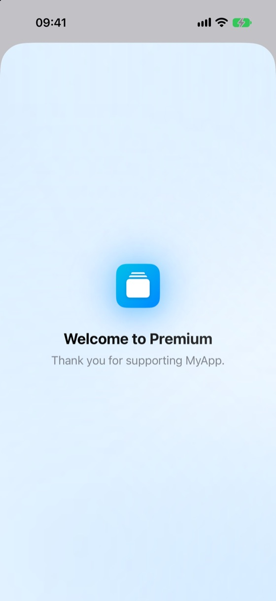
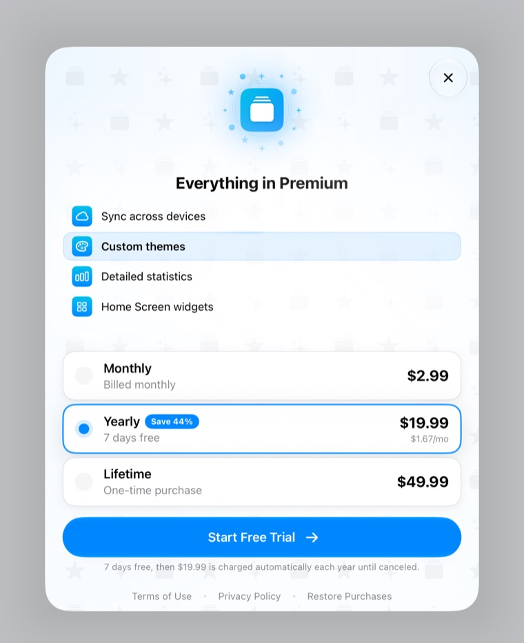
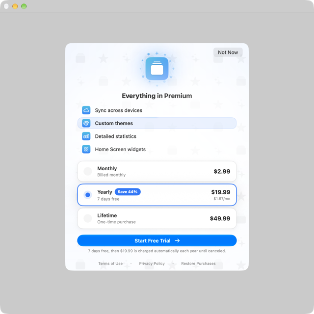
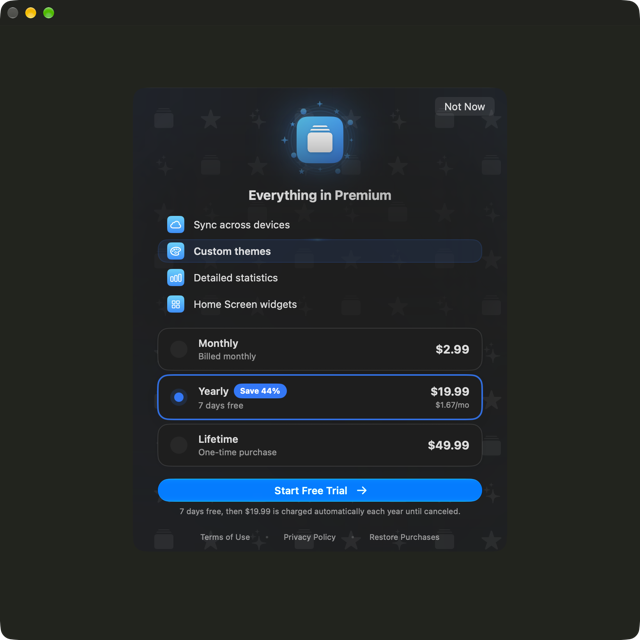

# PaywallKit

[](https://github.com/hksw-io/paywallkit/actions/workflows/ci.yml)

A reusable SwiftUI paywall for iOS and macOS apps in the HK Softworks portfolio: the app icon with
a brand glow, the benefits list, monthly / yearly / lifetime plan cards, a call-to-action that morphs
through purchase, and an in-sheet thank-you celebration.

The kit owns the purchase flow — loading plans, selection, purchase, restore, Ask to Buy, alerts
and the celebration. The app owns StoreKit and entitlement policy behind a small `PaywallService`
protocol. No dependencies.

## Preview

<p>
  
</p>

Choosing a plan morphs the call to action, and a purchase plays the in-sheet thank-you
celebration.

<p>
  
  
  
</p>

The yearly plan with its free trial, per-month price and savings badge; the same sheet in dark
mode; and the celebration after a purchase. The tinted row is `highlightedBenefitID`.

<p>
  
  
  
</p>

On iPad the paywall is a form sheet. On macOS it is a window sheet, and the close button reads
Not Now.

## Requirements

- iOS 26+ / macOS 26+
- Swift 6.2+

## Installation

```swift
.package(url: "https://github.com/hksw-io/paywallkit.git", from: "1.2.0")
```

Or in Xcode: **File > Add Package Dependencies**, enter the URL above, and choose **Up to Next Major Version** from `1.2.0`.

## Usage

Present `PaywallView` in a sheet:

```swift
import PaywallKit
import SwiftUI

.sheet(isPresented: $showsPaywall) {
    PaywallView(
        service: store,
        icon: Image("AppIconImage"),
        benefits: [
            PaywallBenefit(id: "sync", systemImage: "icloud", title: String(localized: "Sync across devices")),
            PaywallBenefit(id: "themes", systemImage: "paintpalette", title: String(localized: "Custom themes")),
        ],
        highlightedBenefitID: "themes",
        thanksLines: [Text("Thank you for supporting MyApp.")],
        privacyPolicy: URL(string: "https://example.com/privacy")!,
        strings: paywallText,
        onDismiss: { showsPaywall = false })
}
```

`highlightedBenefitID` names the feature the user just tried to use; that row is tinted and
announced. Set `brand` and `brandLight` to your brand colours (both default to the accent colour),
pass `wallpaperSymbols` for a faint tiled backdrop, and forward your app's haptics preference as
`hapticsEnabled`. `animatesDecorations: false` stops the celebration's breathing icon and drifting
backdrop and the loading shimmer, for example under UI tests. The highlighted row's halo and the
purchase button's arrow keep moving; only Reduce Motion stops them. Pass `showsDismissButton: false`
to hide the kit's close button (Not Now on Mac) when you provide your own. UI tests can find the
sheet by the accessibility identifier `paywall.sheet`.

`onDismiss` runs when the user taps the close button (or presses Esc on Mac), when the thank-you
celebration ends after a purchase or restore, and when the paywall finds access already active.
Read your own entitlement afterwards to tell them apart. On iOS a swipe-down closes the sheet
without calling it, so put work that must run on every close in the sheet's own `onDismiss`.

### The copy

The kit ships no strings. `strings` returns your app's text for every `PaywallString`, so the
paywall names your subscription and localizes with the rest of your app. An exhaustive `switch`
makes the compiler flag any case you miss, including cases a minor release adds (1.2.0 added
`.benefitsSubtitle`). Keep the function `nonisolated`: the parameter is `@Sendable`, and new Xcode app
targets default to main-actor isolation. This English copy is a starting point:

```swift
import PaywallKit

nonisolated func paywallText(_ string: PaywallString) -> String {
    switch string {
    case .benefitsHeader: String(localized: "Everything in Premium")
    case .benefitsSubtitle: ""
    case .highlightedBenefit: String(localized: "the feature you tried to use")
    case .plan(.monthly): String(localized: "Monthly")
    case .plan(.yearly): String(localized: "Yearly")
    case .plan(.lifetime): String(localized: "Lifetime")
    case .billing(.monthly): String(localized: "Billed monthly")
    case .billing(.yearly): String(localized: "Billed yearly")
    case .billing(.lifetime): String(localized: "One-time purchase")
    case let .savePercent(percent): String(localized: "Save \(percent)%")
    case let .perMonth(price): String(localized: "\(price)/mo")
    case .subscribe: String(localized: "Subscribe")
    case .startTrial: String(localized: "Start Free Trial")
    case .purchase: String(localized: "Purchase")
    case .subscriptionReassurance: String(localized: "Cancel anytime.")
    case .lifetimeReassurance: String(localized: "Yours forever after one purchase.")
    case let .monthlyTrialDisclosure(trial, price):
        String(localized: "\(trial), then \(price) is charged automatically each month until canceled.")
    case let .yearlyTrialDisclosure(trial, price):
        String(localized: "\(trial), then \(price) is charged automatically each year until canceled.")
    case .purchasing: String(localized: "Contacting the App Store…")
    case .complete: String(localized: "Complete")
    case .termsOfUse: String(localized: "Terms of Use")
    case .privacyPolicy: String(localized: "Privacy Policy")
    case .restore: String(localized: "Restore Purchases")
    case .restoreHint: String(localized: "Restore a previous purchase on this Apple Account")
    case .notNow: String(localized: "Not Now")
    case .close: String(localized: "Close")
    case .loadingPlans: String(localized: "Loading plans")
    case .plansUnavailableTitle: String(localized: "Couldn’t Load Plans")
    case .plansUnavailableMessage: String(localized: "Check your connection and try again.")
    case .tryAgain: String(localized: "Try Again")
    case .paymentsUnavailableTitle: String(localized: "Purchases Not Available")
    case .paymentsUnavailableMessage: String(localized: "In-app purchases are turned off for this device or account.")
    case .purchaseFailedTitle: String(localized: "Couldn’t Complete Purchase")
    case .purchaseFailed: String(localized: "The purchase didn’t go through. Try again.")
    case .pendingTitle: String(localized: "Purchase Pending")
    case .pending: String(localized: "Your purchase is awaiting approval. You’ll get access as soon as it’s approved.")
    case .productNotFound: String(localized: "This plan isn’t available right now. Try again later.")
    case .verificationFailed: String(localized: "Your purchase couldn’t be verified. Try again.")
    case .notActivated: String(localized: "This purchase didn’t activate Premium. Try again, or choose Restore Purchases.")
    case .nothingToRestoreTitle: String(localized: "Nothing to Restore")
    case .nothingToRestore: String(localized: "There are no purchases to restore on this account.")
    case .restoreFailedTitle: String(localized: "Couldn’t Restore Purchases")
    case .restoreFailed: String(localized: "Purchases couldn’t be restored. Try again.")
    case .ok: String(localized: "OK")
    case .thanksTitle: String(localized: "Welcome to Premium")
    case .restoredTitle: String(localized: "Purchases Restored")
    case .restoredSubtitle: String(localized: "Your Premium is back.")
    }
}
```

### The service

Conform your store to `PaywallService`. `entitlement` must live on an `@Observable` type: the
paywall watches it to celebrate an approval that arrives while it is open and to close itself when
access is already active. If `entitlement` is `.entitled` when the paywall appears, it closes at
once. A change from `.free` to `.entitled` while it is open plays the celebration; a change from
`.unknown` straight to `.entitled` closes it without one, so settle `.unknown` to `.free` before
presenting.

The kit calls `loadProducts(forceRefresh: false)` when it appears and `forceRefresh: true` from Try
Again, then reads `products` and `canMakePayments`. An empty `products` shows
`.plansUnavailableTitle`; `canMakePayments == false` shows `.paymentsUnavailableTitle`. Plans render
in monthly, yearly, lifetime order, with yearly selected first when it is offered.

A minimal StoreKit 2 conformance:

```swift
import PaywallKit
import StoreKit

@MainActor
@Observable
final class Store: PaywallService {
    private(set) var entitlement: PaywallEntitlement = .unknown
    private(set) var products: [PaywallProduct] = []
    private var storeProducts: [PaywallPlan: Product] = [:]
    private let productIDs: [PaywallPlan: String] = [
        .monthly: "com.example.premium.monthly",
        .yearly: "com.example.premium.yearly",
    ]

    var canMakePayments: Bool {
        AppStore.canMakePayments
    }

    func loadProducts(forceRefresh: Bool) async {
        guard forceRefresh || self.products.isEmpty else { return }
        do {
            let loaded = try await Product.products(for: Array(self.productIDs.values))
            for (plan, id) in self.productIDs {
                self.storeProducts[plan] = loaded.first { $0.id == id }
            }
            self.products = self.storeProducts.map { plan, product in
                PaywallProduct(plan: plan, displayPrice: product.displayPrice, price: product.price)
            }
        } catch {
            self.products = []
        }
    }

    func purchase(_ plan: PaywallPlan) async throws {
        guard let product = self.storeProducts[plan] else { throw PaywallError.productNotFound }
        switch try await product.purchase() {
        case let .success(.verified(transaction)):
            await transaction.finish()
            await self.refreshEntitlement()
            guard self.entitlement == .entitled else { throw PaywallError.notActivated }
        case .success(.unverified):
            throw PaywallError.verificationFailed
        case .pending:
            throw PaywallError.pending
        case .userCancelled:
            throw PaywallError.cancelled
        @unknown default:
            throw PaywallError.failed
        }
    }

    func restorePurchases() async throws {
        try await AppStore.sync()
        await self.refreshEntitlement()
    }

    func refreshEntitlement() async {
        var isEntitled = false
        for await case let .verified(transaction) in Transaction.currentEntitlements
            where transaction.revocationDate == nil
        {
            isEntitled = isEntitled || self.productIDs.values.contains(transaction.productID)
        }
        self.entitlement = isEntitled ? .entitled : .free
    }
}
```

A real app also calls `refreshEntitlement()` at launch, so `entitlement` is `.free` rather than
`.unknown` when the paywall opens, and listens to `Transaction.updates`.
Fill `introductoryOfferText` ("7 days free") and `isEligibleForIntroOffer` from
`product.subscription` to get the trial call to action and the App Store's required
trial-conversion disclosure, and `monthlyEquivalentPrice` to show the yearly plan per month.
Trials apply to monthly and yearly only. The yearly plan's savings badge compares its `price` with
twelve times the monthly plan's `price`, rounded down. It is hidden when either plan is missing,
when either price is 0 (the default), or when the saving is under 1%.

From `purchase(_:)`, throw a `PaywallError` for a specific alert: `.pending` (Ask to Buy; the
button stays disabled while the paywall is open), `.paymentsNotAllowed` (also replaces the plans
with `.paymentsUnavailableTitle`), `.productNotFound`, `.verificationFailed` or `.notActivated`.
`.failed` and any other error show `.purchaseFailed`. `.cancelled`, `CancellationError` and
`StoreKitError.userCancelled` are silent. If `entitlement` is already `.entitled` when
`purchase(_:)` throws, the paywall celebrates instead.

From `restorePurchases()`, cancellation is silent, any other error shows `.restoreFailed`, and
returning without `.entitled` shows `.nothingToRestore`, so update `entitlement` before returning.

## Scope

- Plans are monthly, yearly and lifetime; any subset renders.
- The kit ships no copy; the app supplies every string through `PaywallString`.
- Terms of Use link Apple's standard EULA.

## Accessibility

VoiceOver reads each plan as one button: its name, its price (or, with a trial, the trial
disclosure, which includes the price) and any savings, and marks the selected plan with the
Selected trait. The highlighted benefit adds `.highlightedBenefit` to its label, and the thank-you
title is announced. Accessibility text sizes switch to a scrolling layout. Reduce Motion removes
decorative motion, shows the celebration without animation, and keeps every haptic.

## Local development

```sh
swift test
```

`swift test` builds for macOS only. Build iOS too when touching platform-conditional code:

```sh
xcodebuild -scheme PaywallKit -destination 'generic/platform=iOS Simulator' build
```

The README media was captured from the iOS 27.2 Simulator (iPhone 17 Pro, iPad Pro 11-inch)
and a macOS window, with a fake `PaywallService` whose purchase succeeds.

## License

MIT. See [LICENSE](LICENSE).
